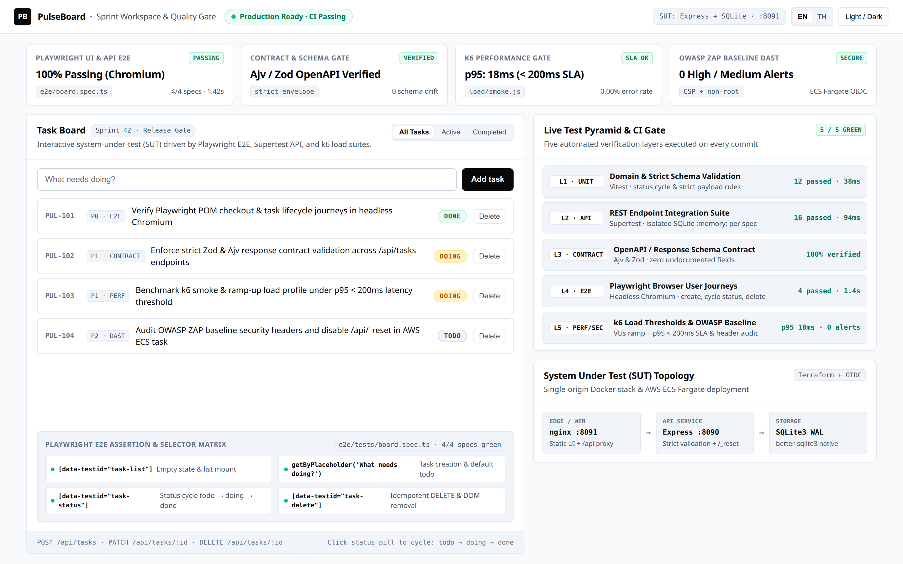

# PulseBoard — Sprint Workspace & Five-Layer Test Automation Showcase

**PulseBoard** is a complete **test-automation engineering showcase**: a real system-under-test (SUT) wrapped in an automated **five-layer quality gate pyramid**. Every layer — from pure domain unit tests up to contract verification, headless Chromium browser E2E, k6 performance load testing, and security baseline checks — runs reproducibly with a single Docker Compose command.

[](https://github.com/peemphetpimolzzz/test-automation-showcase/actions/workflows/ci.yml)
[](LICENSE)



## The System Under Test (SUT)

A **Tasks REST API** (Node.js + TypeScript + Express) backed by **better-sqlite3**, paired with a zero-dependency **PulseBoard Sprint Workspace** web UI served by `nginx`:

- `GET /api/health` — Liveness probe returning `{ status, uptime }`.
- `GET /api/tasks` — List sprint tasks (`{ tasks: [...] }`).
- `POST /api/tasks` — Create a task (`{ title, status? }`).
- `GET /api/tasks/:id` — Fetch a single task by ID.
- `PATCH /api/tasks/:id` — Update title and/or cycle status (`todo → doing → done → todo`).
- `DELETE /api/tasks/:id` — Delete a task.
- `POST /api/_reset` — **Test-only** state reset endpoint; strictly gated by `ENABLE_TEST_RESET=1`.

Validation uses **Zod** in strict mode (unknown keys rejected; `status ∈ {todo, doing, done}`). Errors always follow the structured envelope `{ "error": { "code", "message" } }`. The Express `app` is exported without calling `listen`, enabling fast in-process integration and contract testing with `supertest`.

The **PulseBoard** UI provides:
- **Quality Gate Telemetry Strip**: Live status indicators for Playwright E2E, Contract & Schema verification, k6 `p95 < 200ms` SLA, and OWASP baseline security.
- **Interactive Sprint Task Board**: Create tasks, filter by status (`All Tasks`, `Active`, `Completed`), cycle task status badges (`todo → doing → done → todo`), delete tasks, and switch between `EN / TH` and `Light / Dark` themes.
- **Live Test Pyramid & Topology Console**: Visualizes the 5-layer quality gate and single-origin `nginx → Express → SQLite` architecture.

## The Five-Layer Test Pyramid

| Layer | Tool | What it verifies | Execution Target |
| --- | --- | --- | --- |
| **1. Unit** | `vitest` | Pure domain logic (status state machine, title validation) + strict schema rules | In-process, offline |
| **2. API / Integration** | `supertest` | Every REST endpoint, status codes, 400 validation errors, 404 handling | In-process Express app, isolated `:memory:` SQLite per test |
| **3. Contract** | `zod` response schemas | Every live HTTP response parses strictly against its published contract schema | In-process Express app |
| **4. UI E2E** | `Playwright` | Headless Chromium drives the PulseBoard UI: empty state, create, status cycle, delete | Full Docker stack (`web` + `api`) |
| **5. Performance / Load** | `k6` | Smoke & ramp load profile enforcing `http_req_duration p(95) < 200ms` and `0%` errors | Live API over Compose network |

## Running Locally

Everything runs in Docker — no local Node.js, k6, or browser installation required.

```sh
cp .env.example .env

# Bring up the stack (API on :8090, PulseBoard Web UI on :8091 by default)
docker compose up -d --build

# Verify endpoints
curl http://localhost:8090/api/health
curl -X POST http://localhost:8090/api/tasks -H 'Content-Type: application/json' -d '{"title":"Verify contract schemas"}'
curl http://localhost:8090/api/tasks
# Open http://localhost:8091 in a browser
```

Run each quality gate layer via the test overlay:

```sh
# 1. Unit tests (offline, reuses the SUT build image)
docker compose -f docker-compose.yml -f docker-compose.test.yml run --rm unit

# 2. API + Contract tests (offline, fresh in-memory DB per test)
docker compose -f docker-compose.yml -f docker-compose.test.yml run --rm apitest

# 3. End-to-End Playwright UI tests (against the running stack)
docker compose -f docker-compose.yml -f docker-compose.test.yml run --rm e2e

# 4. k6 Smoke Load test (against the running stack)
docker compose -f docker-compose.yml -f docker-compose.test.yml run --rm k6

# Tear down
docker compose down -v
```

The Playwright HTML report is written to `e2e/playwright-report/`; the k6 metrics summary is written to `load/k6-summary.json`. See [`load/thresholds.md`](load/thresholds.md) for the load profile and SLA rationale.

## Architecture & Docker Highlights

- **Non-conflicting host ports** (`8090` API, `8091` Web) avoid collisions with standard local dev servers; both are configurable via environment variables.
- **Multi-stage native build**: `better-sqlite3` is compiled in a `node:22-bookworm-slim` build stage and copied into a minimal non-root production runtime stage.
- **Offline test stages**: Unit, API, and Contract suites reuse the build stage so they run 100% offline in CI.

## Continuous Integration & AWS Deployment

- **CI Pipeline**: [`.github/workflows/ci.yml`](.github/workflows/ci.yml) runs Unit and API/Contract suites in parallel, boots the Docker stack, executes Playwright E2E and k6 load gates, and uploads test reports as workflow artifacts.
- **AWS ECS Fargate**: Infrastructure is defined as Terraform in [`infra/`](infra/). The [`Deploy (AWS)`](.github/workflows/deploy.yml) workflow authenticates via **GitHub OIDC** (zero long-lived AWS keys), pushes to Amazon ECR, and rolls out a new ECS task revision with `ENABLE_TEST_RESET=0`. See [`docs/deployment.md`](docs/deployment.md) for details.

## License

[MIT](LICENSE) — Part of [Peem Phetpimol's portfolio](https://peemphetpimolzzz.github.io) (Fullstack & Cloud Engineer · Test Automation).
